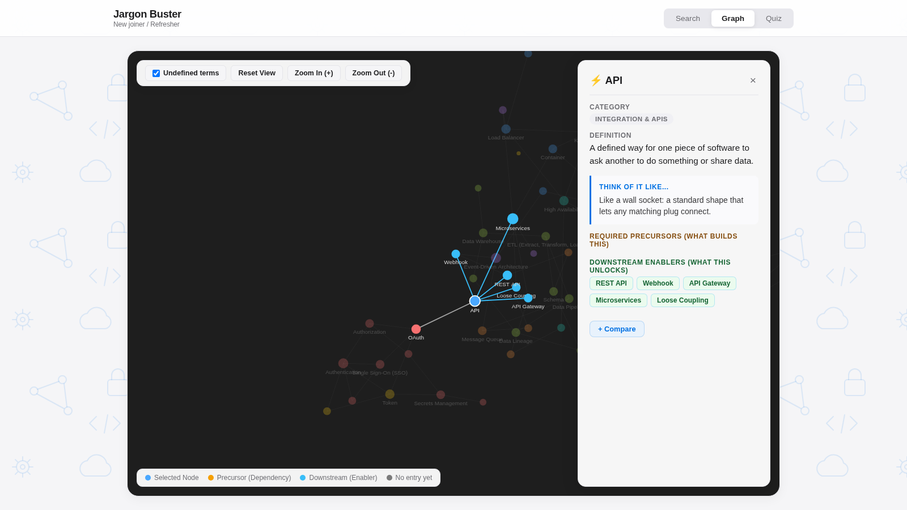

# Jargon Buster

A small web app that explains common tech terms in plain English. Every term comes with a one-line definition, a real-world analogy, and links to the terms it builds on and the terms it unlocks.

I designed it as an onboarding aid for new joiners to a tech team, where the vocabulary can feel like a second language in the first few weeks. This public version uses an original, general-purpose glossary of 67 terms, so it is safe to share and easy to adapt.

**Live demo:** https://jaymagayanes.github.io/jargon-buster/




## What it does

- **Search.** Filter terms by name or category and read each definition and analogy as a card.
- **Graph.** See how terms connect. Pick a term to highlight what it builds on and what it unlocks.
- **Quiz.** Practice in short packs by category, or take a timed exam that covers the whole glossary.
- **Compare.** Select two to five terms and copy a ready-made prompt to paste into an AI assistant, to get a short explanation of how they relate.

## How it is built

Everything the reader sees is one self-contained HTML file with no frameworks and no server. The content lives in plain text files, and a short Python script turns it into the page.

```
batches/*.md      the glossary entries, one file per category
categories.txt    category names and colors
template.html     the page itself (HTML, CSS and JavaScript)
build.py          checks the entries and builds index.html
```

`build.py` also catches mistakes before they reach the page: duplicate ids, missing fields, links to terms that do not exist, and loops in the "builds on" chain.

## Run it

You need Python 3.8 or newer. No extra packages.

```
python build.py --open
```

This rebuilds `index.html` and opens it in your browser. To host it, enable GitHub Pages for this repository (Settings, then Pages, then the `main` branch).

## Add or change a term

Add an entry to any file in `batches/`:

```
## load_balancer
term: Load Balancer
category: Cloud & Infrastructure
eli5: Spreads incoming requests across several servers so none gets overwhelmed.
analogy: Like a host at a busy cafe sending each new group to the table with the shortest wait.
enables: high_availability
related: scalability, kubernetes
```

- `precursors` lists the terms this one builds on, and `enables` lists the terms it unlocks. You only need to write each link once, because the build fills in the other direction.
- `aliases` lets other names point to the same term.
- Run `python build.py` and read the messages it prints.

## Notes

The entries are simplified on purpose. They are a starting point for learning the vocabulary, not a replacement for your own team's documentation.
